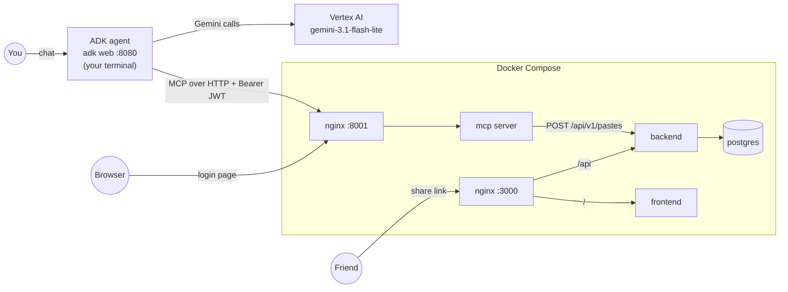
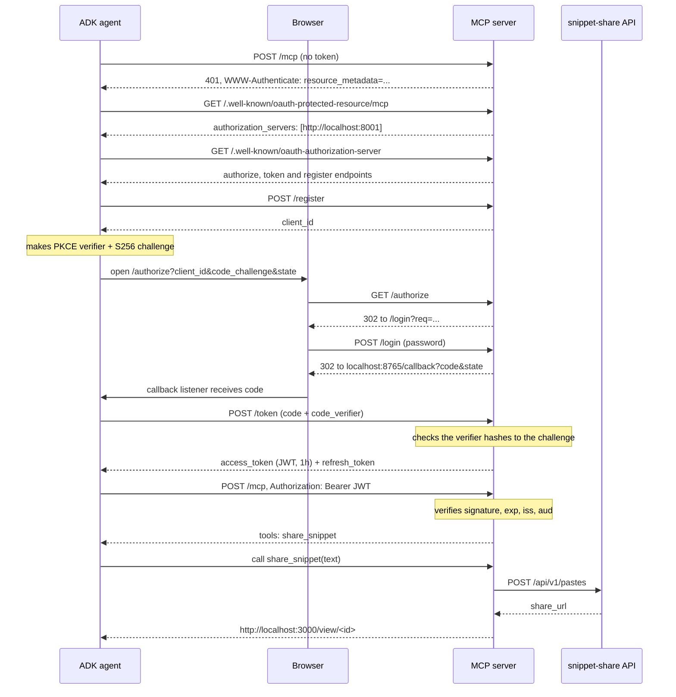

# Testing the agent ↔ MCP server flow

A manual test plan for checking that a real agent can log in to the snippet-share MCP server, receive a JWT, and call `share_snippet` to get a working share link.

> **Port note:** this guide says `8001` for the MCP server. On your machine 8001 is taken by another project, so `.env` sets `MCP_HOST_PORT=8002`. Read every `localhost:8001` below as `localhost:8002`.

## The pieces



| Address | What it is |
|---|---|
| http://localhost:3000 | the snippet-share app; share links point here |
| http://localhost:8001/mcp | the MCP endpoint the agent connects to |
| http://localhost:8001/login | the password page the browser lands on |
| http://localhost:8080 | the ADK web UI where you chat with the agent |

## The login flow, step by step



The agent side is all inside the `mcp` SDK's `OAuthClientProvider`, plus our browser opener and callback listener in [snippet_agent/oauth.py](snippet_agent/oauth.py). The server side is in [mcp-server/auth.py](../mcp-server/auth.py) and [mcp-server/server.py](../mcp-server/server.py).

## Setup (once)

1. Start Docker Desktop.
2. Make sure the repo-root `.env` has `MCP_PASSWORD` and `MCP_JWT_SECRET`; see `.env.example`.
3. Run `gcloud auth application-default login`, so the agent can call Vertex AI.
4. `test-agent/snippet_agent/.env` holds the Vertex settings and `MCP_URL=http://localhost:8001/mcp`.

## Start

**Terminal 1** (repo root):

```powershell
docker compose up --build
```

**Terminal 2:**

```powershell
docker compose logs -f mcp
```

Keep this open. Every OAuth step shows up here as a request line.

**Terminal 3:**

```powershell
cd test-agent
uv run adk web --port 8080
```

## Main scenario: share code with a friend

| # | Do | Expect |
|---|---|---|
| 1 | Open http://localhost:8080 and pick `snippet_agent` | the chat opens |
| 2 | Send: *Write a Python function that checks if a string is a palindrome, then give me a share link for it.* | a browser tab opens on http://localhost:8001/login. Terminal 3 also prints the URL |
| 3 | Look at terminal 2 | `POST /mcp` 401, then the two `/.well-known/...` requests, then `POST /register` 201 and `GET /authorize` 302 |
| 4 | Type the `MCP_PASSWORD` and press Allow | the tab says "Logged in. You can close this tab…" |
| 5 | Look at terminal 2 again | `POST /login` 302, `POST /token` 200, then `POST /mcp` 200 |
| 6 | Look at the chat | the agent shows the code and a link like `http://localhost:3000/view/<id>`. ADK's event panel shows a `share_snippet` function call with the code as `text` |
| 7 | Open the link in a private window (as your friend would) | the snippet page shows exactly the code the agent wrote |
| 8 | Open `http://localhost:3000/api/v1/pastes/<id>/raw` | the same code as plain text |
| 9 | Ask for a second link: *share a JavaScript version too* | a new link. No login tab this time: the agent reuses its JWT |

**Pass:** steps 6 to 9 work, and step 9 needs no new login.

## Negative and edge cases

Run the `curl.exe` commands in PowerShell.

| # | Case | How | Expect | What it shows |
|---|---|---|---|---|
| N1 | No token | `curl.exe -i -X POST http://localhost:8001/mcp -H "Content-Type: application/json" -H "Accept: application/json, text/event-stream" -d "{}"` | `401` and a `www-authenticate` header pointing to the metadata URL | the server refuses anonymous calls and tells clients where to log in |
| N2 | Discovery | `curl.exe http://localhost:8001/.well-known/oauth-protected-resource/mcp` and `curl.exe http://localhost:8001/.well-known/oauth-authorization-server` | JSON naming the login server and its endpoints, with `code_challenge_methods_supported: ["S256"]` | how the agent finds the login server without being told |
| N3 | Made-up token | N1 with `-H "Authorization: Bearer abc.def.ghi"` | `401` | signature checking |
| N4 | Wrong password | restart `adk web` (it forgets its token), ask for a link, type a wrong password | the page shows "Wrong password." and the agent gets no token. Then type the right one and it continues | the login page decides who gets in |
| N5 | Password guessing | on the login page, submit wrong passwords 6+ times quickly | nginx answers `429` | the nginx rate limit on `/login` |
| N6 | App down | `docker compose stop backend`, then ask for a link | the agent reports *Could not reach snippet-share at http://backend:8000. Is the app running?* Then `docker compose start backend` | errors reach the agent through `ToolError` |
| N7 | MCP server restart | `docker compose restart mcp`, then ask for a link | it **still works without logging in** | a JWT is checked by signature, not looked up, so it survives a restart. The refresh token and client registration were in memory and are gone, so after the JWT expires (1h) the agent has to log in again |
| N8 | Signing key changed | change `MCP_JWT_SECRET` in `.env`, run `docker compose up -d mcp`, then ask for a link | the old JWT gets `401`, the refresh fails, and a new login tab opens | every token signed with the old key is invalid at once |
| N9 | Restart the agent | stop and start `adk web`, then ask for a link | a new login tab | the agent keeps tokens in memory only |

## What to look at when analysing

- **`docker compose logs -f mcp`** shows each OAuth and MCP request with its status. The order should match the sequence diagram above.
- **ADK web, events panel** shows each Gemini turn, the `share_snippet` call with its arguments, and the tool's response.
- **Terminal 3** shows the authorization URL printed by the agent, and any ADK errors.
- **Inside the JWT:** the claims are `iss`, `aud`, `sub`, `client_id`, `scope`, `iat`, `exp` and `jti`. Don't paste real tokens into websites like jwt.io. The automated test `mcp-server/tests/test_auth.py::test_access_token_is_signed_jwt` decodes one locally.

## Troubleshooting

| Symptom | Likely cause |
|---|---|
| No login tab opens | copy the URL printed in terminal 3 into a browser |
| "Login failed" or the agent hangs after login | port 8765 is in use: set `OAUTH_CALLBACK_PORT` in `snippet_agent/.env` |
| `invalid_grant` from Google | your Google sign-in expired: run `gcloud auth application-default login` again |
| Model not found | change `AGENT_MODEL` in `snippet_agent/.env` |
| Agent says it has no tools | the MCP server isn't reachable at `MCP_URL`: check `docker compose ps` |
| Links open only on your PC | expected for now: links use `PUBLIC_BASE_URL=http://localhost:3000` until you deploy |
